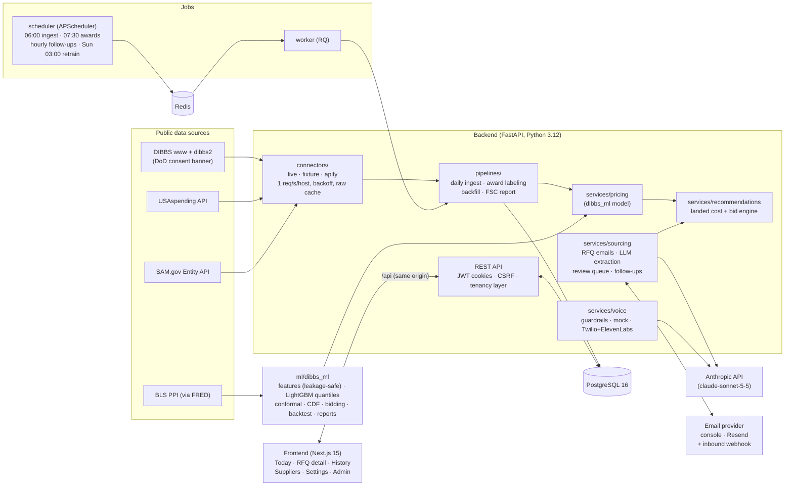

# The Invisible Hand (DLA DIBBS bid pricing; repo: dibbs-bid-copilot)

A multi-tenant SaaS tool for small federal contractors ("brokers") who quote on Defense Logistics Agency
solicitations posted on [DIBBS](https://www.dibbs.bsm.dla.mil/). Every day it:

1. **Ingests** new DIBBS RFQs in each firm's Federal Supply Classes (FSCs).
2. **Enriches** each line with the NSN's procurement history, approved sources and solicitation flags.
3. **Predicts** the distribution of the winning unit price, using LightGBM quantile regression with
   conformal calibration trained on historical DIBBS awards.
4. **Builds a cost floor** by emailing RFQs to the suppliers who can actually supply the part (approved
   sources first) and parsing their replies with an LLM. An optional AI voice module can call suppliers.
5. **Recommends a bid** that maximizes `P(win | bid) × (bid − landed cost) × quantity`, plus conservative
   and aggressive alternatives, or a "no bid" with reasons.
6. Shows it all in a dashboard where each firm sees only its own watchlist, quotes and recommendations.

> **The app never submits bids.** The broker reviews the recommendation and submits on DIBBS themselves.

---

## Quick start

### Docker (target setup)

```bash
cp .env.example .env          # optional: every variable has a working demo default
docker compose up -d --build  # postgres, redis, backend, worker, scheduler, frontend
make seed                     # demo orgs, synthetic history, 40 open RFQ lines, trained model
```

Open **http://localhost:3000** and log in with a demo account. `make seed` prints the accounts and
writes them to `DEMO_CREDENTIALS.md`:

| Role | Email | Password |
|---|---|---|
| Owner, Atlas Federal Supply (demo) | `owner@atlas-demo.example.com` | `AtlasDemo!2026` |
| Owner, Bluewater Parts Co. (demo) | `owner@bluewater-demo.example.com` | `BluewaterDemo!2026` |
| Superadmin (`/admin`) | `admin@copilot-demo.example.com` | `AdminDemo!2026` |

No API keys and no network are needed for the demo: the connectors read captured DIBBS samples, the LLM
is a deterministic mock, email goes to the database, and voice calls are simulated.

### Without Docker (Windows/macOS/Linux, Python 3.12 + Node 20+)

`dev.py` mirrors every Makefile target and starts an embedded PostgreSQL 16 (the `pgserver` pip package),
so nothing else needs installing:

```bash
python dev.py setup    # backend/.venv, Python + npm deps, Playwright browsers
python dev.py seed
python dev.py api      # FastAPI on :8000 (terminal 1)
python dev.py web      # Next.js on :3000 (terminal 2)
```

Redis is optional locally: without it, background jobs run in-process.

### Railway

See [`docs/deploy_railway.md`](docs/deploy_railway.md) for the six services and their variables.

---

## Architecture



**Daily flow.**
1. At 06:00 ET the scheduler enqueues the ingest. The worker accepts the DoD banner, downloads the new
   `inYYMMDD.txt` index and `bqYYMMDD.zip` batch file, and upserts lines in watched FSCs.
2. It fetches each new solicitation's record page and PDF. The PDF yields buyer, NAICS, inspection/FOB,
   packaging, first article, approved sources and the **procurement history table**.
3. It predicts the winning-price distribution, then for every matching organization drafts supplier quote
   requests and writes a recommendation.
4. When a supplier replies, the inbound webhook maps the reply to its request (`quotes+<token>@domain`), the
   LLM extracts a structured quote, and the recommendation is recomputed with the real landed cost.

**Multi-tenancy** lives in one place. `Depends(get_tenant)` binds the request's SQLAlchemy session to the
user's organization. Session hooks then add `organization_id = :org` to every ORM query on tenant-owned
models and refuse cross-org writes (`backend/app/core/tenancy.py`). Public DIBBS data is shared.

See [`CLAUDE.md`](CLAUDE.md) for the code map and conventions, [`DECISIONS.md`](DECISIONS.md) for every
judgment call, and [`docs/data_sources.md`](docs/data_sources.md) for the observed DIBBS formats.

---

## Commands

| Make (Docker) | Without Docker | What it does |
|---|---|---|
| `make up` / `make down` | | Start/stop the stack |
| `make seed` | `python dev.py seed` | Demo data + trained model (idempotent; re-running resets the demo) |
| `make ingest` | `python dev.py ingest` | Daily RFQ ingest (`MODE=live` to hit DIBBS; default `CONNECTOR_MODE`) |
| `make labels` | `python dev.py labels` | Attach newly posted awards to solicitations |
| `make backfill FSC=5305,5310 START=2023-01-01 END=today` | `python dev.py backfill --fsc 5305,5310 --start 2023-01-01 --end today` | Resumable history backfill |
| `make train` | `python dev.py train` | Retrain, evaluate, write `ml/reports/latest_model.md`, promote if better |
| `make fsc-report` | `python dev.py fsc-report` | Write `ml/reports/fsc_volume.md` |
| `make test` | `python dev.py test` + `python dev.py e2e` | pytest (backend + ML), Vitest, Playwright e2e |
| `make lint` | `python dev.py lint` | ruff, ESLint, `tsc --noEmit` |
| `make api-types` | `python dev.py api-types` | Regenerate the typed API client from OpenAPI |

Superadmin: `python -m app.cli create-superadmin you@example.com`.

### Backfill

```bash
make backfill FSC=5305,5306,5310,5330,5340,4730,6145 START=2023-01-01 END=today MODE=live
```

DIBBS only keeps about 30 days of RFQ index files and about 45 days of award listings online. Every
automated (T/U) RFQ PDF, however, carries the NSN's procurement history, often 10+ years deep. The
backfill therefore:

1. walks every available posting date for the FSCs;
2. fetches one PDF per NSN (`--max-pdfs`, default 2000) and stores its history from `START`;
3. walks recent award listings (`--max-award-dates`, `--max-award-pages`);
4. runs an NSN award search for NSNs still without history.

Each unit of work is checkpointed, so re-running resumes. Running the daily ingest for a few weeks keeps
widening NSN coverage. At 1 request/second, 2,000 PDFs take about an hour.

### Training and evaluation

`make train` builds one training row per historical award, with features computed only from strictly
earlier awards (`ml/tests/test_leakage.py` enforces this). It then splits by time:

- **train** on everything up to T−4 months;
- **calibrate** with split-conformal on T−4 to T−3 months (recent residuals calibrate better: prices drift);
- **test** on the last 3 months.

That held-out model decides promotion (it must beat the active model's held-out twin on pinball loss over the
same test window). The model that is deployed is then refit on everything up to T−1 month and calibrated on
the last month, so live prices reflect the latest awards. Accuracy is reported by history depth (no history,
1, 2–4, 5+ awards). Research on production data runs in-cluster (`RESEARCH_RUN`, `app/services/research.py`);
see `ml/research/README.md`.

`ml/reports/latest_model.md` (plus PNG charts) reports the following, and the `/admin` model page shows the
same metrics:

- pinball loss per quantile (the primary metric);
- MAPE of the median and 80%/90% interval coverage;
- P(win) calibration;
- a bidding backtest against "last price − 2%" and "cost + 15%".

A new model is promoted only if it beats the active model's pinball loss on the same test window.

---

## Enabling live integrations

All live integrations are off by default. Set the variables in `.env` and restart.

### Live DIBBS data
```
CONNECTOR_MODE=live
DIBBS_BANNER_MODE=browser   # Playwright (as specified); falls back to "form" (plain POST) automatically
SCRAPER_USER_AGENT=YourCompany-BidCopilot/1.0 (+mailto:you@yourcompany.com)
```
Only public pages are used: no login, no JCP/cFolders/TDMT technical data. Requests are rate-limited to
1/second/host with exponential backoff, and raw responses are cached in `data/raw/dibbs/<date>/`.

### Email (RFQs out, replies in)
```
EMAIL_PROVIDER=resend
RESEND_API_KEY=re_...
EMAIL_FROM=Your Company <quotes@yourdomain.com>
EMAIL_REPLY_DOMAIN=yourdomain.com        # replies go to quotes+<token>@yourdomain.com
INBOUND_EMAIL_SECRET=<long random string>
```
Point your inbound-email service (Resend inbound, SendGrid Inbound Parse, Postmark, Mailgun, ...) at
`POST https://<api-host>/api/webhooks/inbound-email` with this JSON body:

```json
{"from": "...", "to": "quotes+<token>@yourdomain.com", "cc": "...", "subject": "...", "text": "...", "html": "...",
 "message_id": "...", "attachments": [{"filename": "quote.pdf", "content_type": "application/pdf", "content_base64": "..."}]}
```

Sign it with header `X-Inbound-Signature: hex(HMAC-SHA256(INBOUND_EMAIL_SECRET, raw_body))`. Most providers
need a small adapter (a few lines in a serverless function) to map their payload to this shape.

### LLM (email drafting + quote extraction)
```
ANTHROPIC_API_KEY=sk-ant-...
LLM_MODEL=claude-sonnet-5-5
LLM_REFUSAL_FALLBACK=true
```
Calls use JSON-schema structured outputs, are re-validated with Pydantic, and fall back to the strict
template if an email draft drops a required fact.

### Voice (optional)
```
VOICE_ENABLED=true
VOICE_PROVIDER=twilio_elevenlabs
TWILIO_ACCOUNT_SID=... TWILIO_AUTH_TOKEN=... TWILIO_FROM_NUMBER=+1...
ELEVENLABS_API_KEY=... ELEVENLABS_AGENT_ID=... ELEVENLABS_PHONE_NUMBER_ID=... ELEVENLABS_WEBHOOK_SECRET=...
PUBLIC_API_BASE_URL=https://<api-host>
OPENAI_API_KEY=...   # optional: Whisper transcription only if the agent returns no transcript
```

Setup:

1. Create an ElevenLabs Conversational AI agent with the system prompt in
   `backend/app/services/voice/providers.py` (`AGENT_SYSTEM_PROMPT`).
2. Import your Twilio number into ElevenLabs.
3. Set the post-call webhook to `/api/webhooks/elevenlabs`, and the Twilio status callback to
   `/api/webhooks/twilio/status`.
4. Owners turn calling on per organization in Settings.

Guardrails are enforced in code, not just the prompt, and covered by tests:

- landline or explicit consent only;
- supplier business hours (Mon–Fri 09:00–17:00 local) only;
- at most one call per supplier per day;
- the agent discloses that it is an AI and asks for consent to record.

For a classroom demo, add your own phone numbers as consenting test contacts.

---

## Environment variables

| Variable | Default | Purpose |
|---|---|---|
| `DATABASE_URL` | compose Postgres | SQLAlchemy URL (Postgres 16; SQLite only for local dev/tests) |
| `REDIS_URL` | compose Redis | RQ jobs + rate limiting; empty = in-process jobs |
| `JWT_SECRET` | dev value | Signs access tokens. **Change in production** |
| `COOKIE_SECURE` | `false` | `true` behind HTTPS |
| `FRONTEND_ORIGIN` | `http://localhost:3000` | CORS origin and links in emails |
| `DEMO_MODE` | `true` | Enables the `simulate-reply` endpoint (demo quote replies) |
| `PUBLIC_DEMO` | `false` | "Explore the live demo": one-click read-only session in the Atlas demo org |
| `DEMO_PASSWORD_LOGIN` | `true` | `false` locks the seeded demo accounts (their passwords are published) at every boot |
| `BOOTSTRAP_ADMIN_EMAIL`, `BOOTSTRAP_ADMIN_PASSWORD` | empty | Superadmin ensured at boot; the variable is the source of truth for its password (min 12 chars) |
| `NIGHTLY_BACKFILL` | `true` | Live mode: 01:00 ET incremental backfill on the bulk queue |
| `OPS_ALERT_EMAIL` | empty | Emailed (at most every 12 h) while data is stale or a pipeline fails |
| `WORKER_POOLS` | `default;bulk` | Worker processes, one per `;`-separated pool of queues |
| `LOG_LEVEL` | `INFO` | Backend log level |
| `ANTHROPIC_API_KEY` | empty | Enables the real LLM (else the deterministic mock) |
| `LLM_MODEL` | `claude-sonnet-5-5` | Model for drafting/extraction |
| `LLM_PROVIDER` | auto | `anthropic` or `mock` |
| `LLM_REFUSAL_FALLBACK` | `true` | Server-side refusal fallback |
| `EMAIL_PROVIDER` | `console` | `console` (DB outbox) or `resend` |
| `RESEND_API_KEY` | empty | Resend API key |
| `EMAIL_FROM` | demo | From address |
| `EMAIL_REPLY_DOMAIN` | demo | Domain for `quotes+<token>@` reply-to addresses |
| `INBOUND_EMAIL_SECRET` | dev value | HMAC secret for the inbound email webhook |
| `SAM_API_KEY` | empty | SAM.gov Entity API (CAGE → UEI); optional |
| `APIFY_TOKEN`, `APIFY_DIBBS_ACTOR` | empty | Optional Apify fallback for the RFQ index |
| `SCRAPER_USER_AGENT` | identifying UA | Sent on every scraper request; put a contact address in it |
| `CONNECTOR_MODE` | `fixture` | `fixture` (offline samples) / `live` / `apify` |
| `DIBBS_BANNER_MODE` | `browser` | `browser` (Playwright) or `form` (plain POST) |
| `DETAIL_FETCH_LIMIT` | `600` | Record pages + PDFs per ingest run |
| `RAW_CACHE_DIR` | `./data/raw` | Raw response cache |
| `VOICE_ENABLED` | `false` | Global voice flag |
| `VOICE_PROVIDER` | `mock` | `mock` or `twilio_elevenlabs` |
| `TWILIO_ACCOUNT_SID`, `TWILIO_AUTH_TOKEN`, `TWILIO_FROM_NUMBER` | empty | Telephony + status-callback signature check |
| `ELEVENLABS_API_KEY`, `ELEVENLABS_AGENT_ID`, `ELEVENLABS_PHONE_NUMBER_ID`, `ELEVENLABS_WEBHOOK_SECRET` | empty | Conversational agent + post-call webhook |
| `OPENAI_API_KEY` | empty | Whisper post-call transcription fallback only |
| `PUBLIC_API_BASE_URL` | `http://localhost:8000` | Public backend URL for webhook signature checks |
| `MODEL_ARTIFACT_DIR` | `./ml/artifacts` | Model artifacts |

Every variable is also documented in [`.env.example`](.env.example).

## External dependencies

| Dependency | Needed for | Without it |
|---|---|---|
| DIBBS (public site) | live RFQs, history, awards | fixture mode (real captured samples) |
| Anthropic API | polished emails, robust extraction | deterministic template + regex mock |
| Resend (or another provider) + inbound parse | real supplier emails | console provider (DB outbox), `simulate-reply` |
| Twilio + ElevenLabs (+ optional OpenAI Whisper) | AI calls | mock voice provider |
| SAM.gov Entity API | UEI / registration details | DIBBS CAGE pop-up only |
| USAspending API | cross-check award totals | skipped |
| FRED / BLS PPI | refreshing `ml/data/ppi.csv` (`python ml/scripts/refresh_ppi.py`) | the committed CSV |
| Apify | fallback RFQ index source | direct DIBBS (default) |

---

## Testing

```bash
make test          # Docker: backend + ML pytest, Vitest, Playwright e2e (seeds first)
python dev.py test # local: pytest + Vitest
python dev.py e2e  # local: Playwright (reuses or starts the API and web servers)
```

| Area | Where |
|---|---|
| Parsers against real DIBBS samples | `backend/tests/test_parsers.py` |
| Banner handling, rate limiting, retries (no network) | `backend/tests/test_connectors.py` |
| Fixture-mode ingest, labeling, backfill | `backend/tests/test_pipelines.py` |
| Leakage test (future awards can't change any feature) | `ml/tests/test_leakage.py` |
| Recommendation math vs analytic lognormal optima | `ml/tests/test_cdf_and_bidding.py` |
| Training, conformal coverage, promotion, report | `ml/tests/test_training.py` |
| Tenancy isolation across every tenant endpoint | `backend/tests/test_tenancy.py` |
| Auth: signup/login/refresh/CSRF/rate limits/reset/invites | `backend/tests/test_auth.py` |
| Sourcing: drafts, signed webhook, extraction, review queue, follow-ups | `backend/tests/test_sourcing.py` |
| LLM: mock extraction, Anthropic client against a fake SDK | `backend/tests/test_llm.py` |
| Voice guardrails, mock calls, webhook signatures | `backend/tests/test_voice.py` |
| Frontend utilities | `frontend/src/lib/lib.test.ts` (Vitest) |
| End-to-end: sign up → log in → today's RFQs → open one → recommendation | `frontend/e2e/copilot.spec.ts` (Playwright) |

The backend suite runs on real PostgreSQL. It uses `TEST_DATABASE_URL` in Docker, otherwise an embedded
Postgres 16, otherwise SQLite. Migrations are applied by Alembic, so they're tested too.

---

## Known limitations

- **P(win) is an approximation.** DIBBS only reveals the winning price, never losing bids. The model
  predicts the distribution of the winning price W and uses P(win | b) ≈ P(W > b). That assumes the lowest
  acceptable offer wins, and ignores past-performance scoring, ties, price-reasonableness rejections and
  buyers who don't award at all.
- **Demo metrics come from synthetic data.** `make seed` trains on synthetic history so the demo works
  offline. Its report shows the pipeline works, not how accurate real predictions are. For real metrics,
  see [`ml/reports/live_snapshot_2026-10-09/`](ml/reports/live_snapshot_2026-10-09/): a bounded live
  backfill (400 NSNs, about 6k real award rows). Results on the last 3 months:

  | Metric | LightGBM + conformal | Baseline |
  |---|---|---|
  | Mean pinball loss | 0.268 | 0.296 |
  | Median absolute error | 15% | 17% |
  | 80% / 90% coverage | 78% / 87% | 77% / 84% |

  Cold-start NSNs (no prior award, 31% of test rows) are much harder: MAPE of the median is 157% there,
  versus 21% for NSNs with history. More backfill coverage helps directly.
- **Backtest assumption.** The spec's landed-cost assumption (W × U(0.6, 0.95)) gives "cost + 15%" nearly
  oracle information. The report explains this; `last_minus_2pct` is the fairer naive benchmark.
- **DIBBS coverage.** There's no public procurement-history page. History comes from automated-RFQ PDFs
  (manual Q-type PDFs have none), recent award listings and NSN award searches. Award listings show totals
  only, so unit prices need our line quantity or the award PDF. Set-aside status isn't in the PDF text
  layer (the index/bq code is used instead). PDFs with several different NSNs weren't observed (layout
  UNVERIFIED).
- **Unverified integrations.** cage.dla.mil (requires accepting a separate usage agreement, so not used),
  the SAM.gov Entity API (no key during the build), the Apify actor (no token), Resend, Twilio and
  ElevenLabs are implemented from public documentation and tested with mocks or signature tests, but not
  against the live services.
- **Docker wasn't run during the build.** The build machine had no Docker. Compose, the Dockerfiles and the
  Makefile are written for the target environment; everything they run was verified locally on Windows
  through `dev.py` with an embedded PostgreSQL 16, including the full test suite, a fixture-mode ingest,
  `next build` and the Playwright e2e test.
- **Local Windows dev.** RQ workers need `fork`, so local jobs run in-process threads; the Docker worker
  uses RQ normally.
- **Legal pages are a starting point.** `/terms` and `/privacy` describe what the product actually does, but
  they were not written by a lawyer; have them reviewed before charging customers.
- **Approved-source logic** treats AMSC B/C/D/H/P/R and source-controlled items as approved-source-only.
  Brokers can still quote other parts; they're flagged non-conforming.
- Recommendations are decision support. Price-reasonableness, Buy American/Berry, quality (AS9100),
  packaging and first-article requirements still need the broker's judgment.

## Repository layout

```
backend/   FastAPI app, connectors, pipelines, services, jobs, Alembic, tests (+ real DIBBS fixtures)
ml/        dibbs_ml package (features, models, conformal, CDF, bidding, evaluation, backtest, reports),
           PPI data, reports, tests
frontend/  Next.js 15 app (App Router, TypeScript, Tailwind, shadcn-style UI, TanStack Query, Recharts)
infra/     Dockerfiles, Postgres init
docs/      data_sources.md: observed DIBBS formats
```
