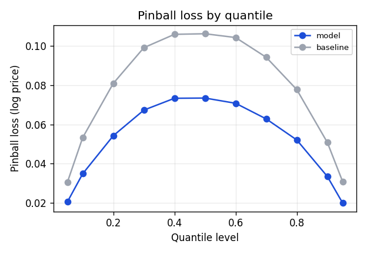

# Latest pricing model

Model run **#1**: **promoted** to active (forced (no comparable active model)).

_Trained on 1,636 award rows, of which 1,636 are the synthetic demo history from `make seed`. Metrics on synthetic data show the pipeline works; they are not evidence about real DIBBS prices._

## Data and time windows

Time-based split, never random: train on everything up to T-6 months, conformal calibration on T-6..T-3 months, test on T-3 months..T.

| Window | Dates | Rows |
|---|---|---|
| Train | 2023-01-02 .. 2026-04-09 | 1,414 |
| Calibrate | 2026-04-09 .. 2026-07-09 | 115 |
| Test | 2026-07-09 .. 2026-10-09 | 107 |

Cold-start share of test rows (no prior award for the NSN): 0.0%.

## Accuracy on the test window

Target: log(winning unit price / reference price). Pinball loss is averaged over the 11 quantiles in log-price space (**primary metric**, lower is better).

| Metric | LightGBM + conformal | LightGBM (uncalibrated) | Baseline |
|---|---|---|---|
| Mean pinball loss | **0.0512** | 0.0513 | 0.0758 |
| MAPE of median | 14.8% | 15.3% | 20.8% |
| Median abs. % error | 12.9% | 12.0% | 13.9% |
| 80% interval coverage | 84.1% | 72.0% | 81.3% |
| 90% interval coverage | 90.7% | 82.2% | 88.8% |

### Quantile coverage

| Level | 0.05 | 0.10 | 0.20 | 0.30 | 0.40 | 0.50 | 0.60 | 0.70 | 0.80 | 0.90 | 0.95 |
|---|---|---|---|---|---|---|---|---|---|---|---|
| Model | 0.06 | 0.07 | 0.19 | 0.26 | 0.36 | 0.44 | 0.54 | 0.71 | 0.86 | 0.92 | 0.96 |
| Before conformal | 0.09 | 0.14 | 0.23 | 0.33 | 0.45 | 0.52 | 0.60 | 0.71 | 0.79 | 0.86 | 0.92 |
| Baseline | 0.04 | 0.07 | 0.13 | 0.18 | 0.29 | 0.42 | 0.55 | 0.69 | 0.79 | 0.88 | 0.93 |

## P(win) calibration

For every test line, 5 bids are sampled around the reference price (b = ref x exp(N(0, 0.25))). Predicted P(win) = P(W > b) is bucketed and compared with how often the actual winning price was above the bid.

| Predicted bucket | Mean predicted | Observed | Count |
|---|---|---|---|
| 0.0-0.1 | 0.043 | 0.000 | 75 |
| 0.1-0.2 | 0.150 | 0.140 | 43 |
| 0.2-0.3 | 0.250 | 0.191 | 47 |
| 0.3-0.4 | 0.348 | 0.351 | 57 |
| 0.4-0.5 | 0.456 | 0.619 | 21 |
| 0.5-0.6 | 0.550 | 0.636 | 33 |
| 0.6-0.7 | 0.649 | 0.719 | 32 |
| 0.7-0.8 | 0.761 | 0.707 | 41 |
| 0.8-0.9 | 0.852 | 0.867 | 75 |
| 0.9-1.0 | 0.976 | 0.991 | 111 |

Brier score 0.1179, expected calibration error 0.0377 (baseline: Brier 0.1729, ECE 0.0597).

## Bidding backtest

Assumption: landed cost = winning price x U(0.6, 0.95); bid wins iff bid < winning price. Model policy uses the recommendation engine with a 5% minimum margin and skips no-bid lines.

| Policy | Bids | Wins | Win rate | Total profit | Profit per bid | Wins below cost |
|---|---|---|---|---|---|---|
| model | 107 | 38 | 35.5% | $16,378 | $153.06 | 0 |
| last_minus_2pct | 107 | 68 | 63.6% | $3,250 | $30.37 | 28 |
| cost_plus_15pct | 107 | 84 | 78.5% | $26,889 | $251.30 | 0 |

## Top features (median model, share of gain)

| Feature | Importance |
|---|---|
| log_qty_vs_last | 12.8% |
| qty_rel_median | 9.2% |
| f_min | 8.7% |
| f_max | 7.6% |
| log_last_to_dod | 7.0% |
| trend_per_year | 6.8% |
| volatility | 6.3% |
| f_last3_median | 5.9% |
| log_quantity | 5.4% |
| inflation_change | 4.8% |
| days_since_last_award | 4.7% |
| log_ref_price | 4.5% |
| n_prior_awards | 3.4% |
| incumbent_share | 2.9% |
| type_code | 1.8% |

## Caveats

- Only winning prices are observed, never losing bids, so P(win) = P(W > bid) is an approximation: it assumes the lowest acceptable price wins and ignores past-performance scoring and ties.
- The backtest's landed-cost assumption is synthetic; real profit depends on actual supplier quotes.
- Under that assumption the landed cost is itself a noisy copy of the winning price (cost ~ 0.775 x W), so `cost_plus_15pct` effectively sees the answer: its bid is W x U(0.69, 1.09). The model policy deliberately does not use cost to predict W (only to compute margin), so this comparison flatters cost-plus. Real supplier costs are far less tightly tied to the winning price; `last_minus_2pct` is the fairer naive benchmark.
