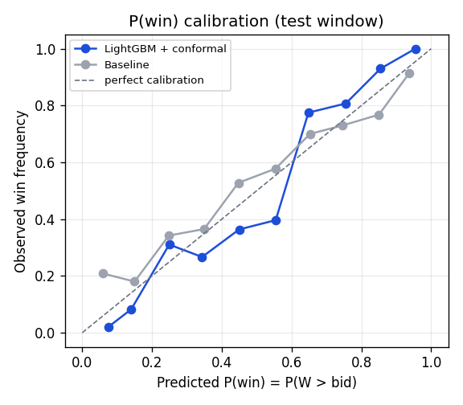

# Latest pricing model

Model run **#2**: not promoted (pinball 0.0610 >= active 0.0610).

_Trained on 1,766 award rows, of which 1,762 are the synthetic demo history from `make seed`. Metrics on synthetic data show the pipeline works; they are not evidence about real DIBBS prices._

## Data and time windows

Time-based split, never random: train on everything up to T-4 months, conformal calibration on T-4..T-3 months, test on T-3 months..T. The deployed model is then refit on everything up to T-1 month and calibrated on the last month.

| Window | Dates | Rows |
|---|---|---|
| Train | 2023-01-02 .. 2026-07-18 | 1,611 |
| Calibrate | 2026-07-18 .. 2026-08-18 | 37 |
| Test | 2026-08-18 .. 2026-11-18 | 118 |

Cold-start share of test rows (no prior award for the NSN): 0.0%.

## Accuracy on the test window

Target: log(winning unit price / reference price). Pinball loss is averaged over the 11 quantiles in log-price space (**primary metric**, lower is better).

| Metric | LightGBM + conformal | LightGBM (uncalibrated) | Baseline |
|---|---|---|---|
| Mean pinball loss | **0.0610** | 0.0585 | 0.1020 |
| MAPE of median | 17.1% | 16.3% | 29.4% |
| Median abs. % error | 13.5% | 12.6% | 22.5% |
| 80% interval coverage | 95.8% | 69.5% | 73.7% |
| 90% interval coverage | 98.3% | 79.7% | 82.2% |

Previously active model on the same test window: pinball 0.0610, 80% coverage 95.8%.

### Quantile coverage

| Level | 0.05 | 0.10 | 0.20 | 0.30 | 0.40 | 0.50 | 0.60 | 0.70 | 0.80 | 0.90 | 0.95 |
|---|---|---|---|---|---|---|---|---|---|---|---|
| Model | 0.01 | 0.02 | 0.11 | 0.28 | 0.42 | 0.57 | 0.64 | 0.81 | 0.86 | 0.97 | 0.99 |
| Before conformal | 0.08 | 0.12 | 0.21 | 0.35 | 0.42 | 0.49 | 0.54 | 0.63 | 0.71 | 0.81 | 0.88 |
| Baseline | 0.08 | 0.10 | 0.20 | 0.29 | 0.36 | 0.49 | 0.61 | 0.67 | 0.77 | 0.84 | 0.90 |

## P(win) calibration

For every test line, 5 bids are sampled around the reference price (b = ref x exp(N(0, 0.25))). Predicted P(win) = P(W > b) is bucketed and compared with how often the actual winning price was above the bid.

| Predicted bucket | Mean predicted | Observed | Count |
|---|---|---|---|
| 0.0-0.1 | 0.075 | 0.021 | 48 |
| 0.1-0.2 | 0.140 | 0.082 | 85 |
| 0.2-0.3 | 0.249 | 0.310 | 29 |
| 0.3-0.4 | 0.343 | 0.267 | 75 |
| 0.4-0.5 | 0.450 | 0.364 | 22 |
| 0.5-0.6 | 0.555 | 0.396 | 53 |
| 0.6-0.7 | 0.648 | 0.775 | 40 |
| 0.7-0.8 | 0.755 | 0.807 | 83 |
| 0.8-0.9 | 0.855 | 0.930 | 86 |
| 0.9-1.0 | 0.955 | 1.000 | 69 |

Brier score 0.1270, expected calibration error 0.0751 (baseline: Brier 0.2098, ECE 0.0517).

## Bidding backtest

Assumption: landed cost = winning price x U(0.6, 0.95); bid wins iff bid < winning price. Every policy is held to the same rules: no bid below landed cost + 5% and none with less than 5% chance of winning; each bid placed is charged $15 of effort.

| Policy | Bids | Withheld by rules | Wins | Win rate | Total profit | Net of effort | Net per line | Wins below cost |
|---|---|---|---|---|---|---|---|---|
| model | 118 | 0 | 21 | 17.8% | $98,712 | $96,942 | $821.54 | 0 |
| last_minus_2pct | 77 | 41 | 28 | 36.4% | $147,870 | $146,715 | $1,243.35 | 0 |
| cost_plus_15pct | 118 | 0 | 93 | 78.8% | $268,719 | $266,949 | $2,262.28 | 0 |

## Top features (median model, share of gain)

| Feature | Importance |
|---|---|
| log_last_to_dod | 12.8% |
| qty_rel_median | 8.9% |
| log_qty_vs_last | 8.4% |
| f_min | 7.5% |
| f_max | 7.2% |
| trend_per_year | 6.2% |
| f_last3_median | 5.8% |
| log_ref_price | 5.6% |
| volatility | 5.5% |
| days_since_last_award | 4.9% |
| log_quantity | 4.0% |
| inflation_change | 4.0% |
| incumbent_share | 3.3% |
| n_prior_awards | 3.0% |
| fam_log_ref_vs_fsc | 2.1% |

## Caveats

- Only winning prices are observed, never losing bids, so P(win) = P(W > bid) is an approximation: it assumes the lowest acceptable price wins and ignores past-performance scoring and ties.
- The backtest's landed-cost assumption is synthetic; real profit depends on actual supplier quotes.
- Under that assumption the landed cost is itself a noisy copy of the winning price (cost ~ 0.775 x W), so `cost_plus_15pct` effectively sees the answer: its bid is W x U(0.69, 1.09). The model policy deliberately does not use cost to predict W (only to compute margin), so this comparison flatters cost-plus. Real supplier costs are far less tightly tied to the winning price; `last_minus_2pct` is the fairer naive benchmark.
