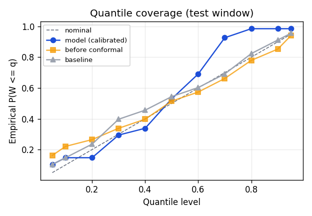
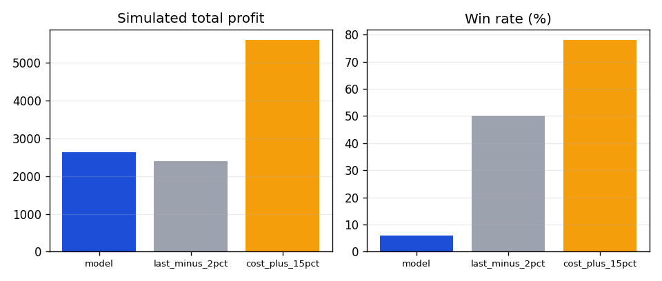

# Latest pricing model

Model run **#1**: **promoted** to active (forced (no comparable active model)).

_Trained on 1,454 award rows, of which 1,454 are the synthetic demo history from `make seed`. Metrics on synthetic data show the pipeline works; they are not evidence about real DIBBS prices._

## Data and time windows

Time-based split, never random: train on everything up to T-4 months, conformal calibration on T-4..T-3 months, test on T-3 months..T. The deployed model is then refit on everything up to T-1 month and calibrated on the last month.

| Window | Dates | Rows |
|---|---|---|
| Train | 2023-01-01 .. 2026-06-14 | 1,353 |
| Calibrate | 2026-06-14 .. 2026-07-14 | 33 |
| Test | 2026-07-14 .. 2026-10-14 | 68 |

Cold-start share of test rows (no prior award for the NSN): 0.0%.

## Accuracy on the test window

Target: log(winning unit price / reference price). Pinball loss is averaged over the 11 quantiles in log-price space (**primary metric**, lower is better).

| Metric | LightGBM + conformal | LightGBM (uncalibrated) | Baseline |
|---|---|---|---|
| Mean pinball loss | **0.0677** | 0.0625 | 0.0955 |
| MAPE of median | 18.5% | 18.3% | 30.3% |
| Median abs. % error | 12.6% | 12.7% | 20.0% |
| 80% interval coverage | 83.8% | 63.2% | 76.5% |
| 90% interval coverage | 88.2% | 77.9% | 85.3% |

### Quantile coverage

| Level | 0.05 | 0.10 | 0.20 | 0.30 | 0.40 | 0.50 | 0.60 | 0.70 | 0.80 | 0.90 | 0.95 |
|---|---|---|---|---|---|---|---|---|---|---|---|
| Model | 0.10 | 0.15 | 0.15 | 0.29 | 0.34 | 0.53 | 0.69 | 0.93 | 0.99 | 0.99 | 0.99 |
| Before conformal | 0.16 | 0.22 | 0.26 | 0.34 | 0.40 | 0.51 | 0.57 | 0.66 | 0.78 | 0.85 | 0.94 |
| Baseline | 0.10 | 0.15 | 0.24 | 0.40 | 0.46 | 0.54 | 0.60 | 0.69 | 0.82 | 0.91 | 0.96 |

## P(win) calibration

For every test line, 5 bids are sampled around the reference price (b = ref x exp(N(0, 0.25))). Predicted P(win) = P(W > b) is bucketed and compared with how often the actual winning price was above the bid.

| Predicted bucket | Mean predicted | Observed | Count |
|---|---|---|---|
| 0.0-0.1 | 0.052 | 0.000 | 27 |
| 0.1-0.2 | 0.161 | 0.000 | 23 |
| 0.2-0.3 | 0.257 | 0.022 | 45 |
| 0.3-0.4 | 0.355 | 0.179 | 56 |
| 0.4-0.5 | 0.445 | 0.241 | 29 |
| 0.5-0.6 | 0.552 | 0.680 | 25 |
| 0.6-0.7 | 0.649 | 0.808 | 26 |
| 0.7-0.8 | 0.750 | 0.750 | 40 |
| 0.8-0.9 | 0.856 | 0.944 | 18 |
| 0.9-1.0 | 0.968 | 0.941 | 51 |

Brier score 0.1233, expected calibration error 0.1226 (baseline: Brier 0.1917, ECE 0.0663).

## Bidding backtest

Assumption: landed cost = winning price x U(0.6, 0.95); bid wins iff bid < winning price. Model policy uses the recommendation engine with a 5% minimum margin and skips no-bid lines.

| Policy | Bids | Wins | Win rate | Total profit | Profit per bid | Wins below cost |
|---|---|---|---|---|---|---|
| model | 68 | 4 | 5.9% | $2,642 | $38.85 | 0 |
| last_minus_2pct | 68 | 34 | 50.0% | $2,404 | $35.36 | 15 |
| cost_plus_15pct | 68 | 53 | 77.9% | $5,604 | $82.41 | 0 |

## Top features (median model, share of gain)

| Feature | Importance |
|---|---|
| qty_rel_median | 10.7% |
| f_min | 9.1% |
| log_last_to_dod | 8.0% |
| log_qty_vs_last | 7.8% |
| trend_per_year | 7.3% |
| f_max | 7.1% |
| f_last3_median | 6.7% |
| volatility | 6.3% |
| log_ref_price | 6.0% |
| days_since_last_award | 5.4% |
| log_quantity | 5.2% |
| inflation_change | 4.1% |
| incumbent_share | 3.6% |
| n_prior_awards | 2.6% |
| type_code | 2.4% |

## Caveats

- Only winning prices are observed, never losing bids, so P(win) = P(W > bid) is an approximation: it assumes the lowest acceptable price wins and ignores past-performance scoring and ties.
- The backtest's landed-cost assumption is synthetic; real profit depends on actual supplier quotes.
- Under that assumption the landed cost is itself a noisy copy of the winning price (cost ~ 0.775 x W), so `cost_plus_15pct` effectively sees the answer: its bid is W x U(0.69, 1.09). The model policy deliberately does not use cost to predict W (only to compute margin), so this comparison flatters cost-plus. Real supplier costs are far less tightly tied to the winning price; `last_minus_2pct` is the fairer naive benchmark.
